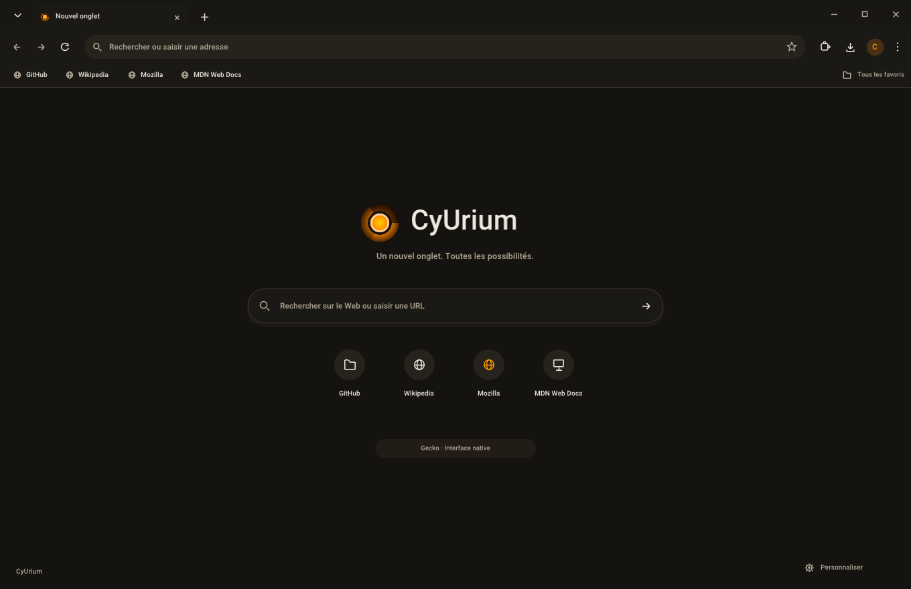

<table width="100%">
  <tr>
    <td width="300" align="left" valign="top">
      <a href="https://github.com/MrMybal/CyUrium">Dépôt</a><br>
      <a href="docs/architecture.md">Architecture</a><br>
      <a href="docs/sdk.md">Guide SDK / MCP</a><br><br>
      <sub>README</sub><br>
      <a href="README.md">English</a> · <a href="README.fr.md">Français</a>
    </td>
    <td width="400" align="center" valign="middle">
      
    </td>
    <td width="300" align="right" valign="top">
      <p><sub>Licence de l’application</sub><br><a href="LICENSE"><strong>GPL-3.0-only</strong></a></p>
      <p><sub>Version</sub><br><a href="VERSION.fr.md"><strong>0.3.0</strong></a><br><strong>ALPHA</strong></p>
    </td>
  </tr>
</table>

<h1 align="center">CyUrium</h1>

Un navigateur de bureau natif avec une interface inspirée de Chrome, le rendu
web Gecko, des onglets déplaçables et un panneau de conversation IA intégré.
Son interface C++20 utilise Dear ImGui et SDL3 GPU, avec le logo original de
CyVR_Urium et un thème brun et ambre.

> **ALPHA · 0.3.0**
>
> Un navigateur Windows expérimental pour les essais et les retours utilisateurs.
> Certaines fonctions restent incomplètes. macOS et Linux disposent actuellement
> de l’interface de bureau uniquement. Consulter les
> [notes de version et limites connues](VERSION.fr.md).

[](docs/screenshots/dark.png)

## À propos de CyUrium

Chaque page possède son onglet. Faites glisser un onglet dans sa barre, vers une
autre fenêtre ou hors des barres pour créer une fenêtre. Le document, l’état du
formulaire et l’historique de navigation suivent l’onglet. Échap annule le
déplacement ; fermer le dernier onglet d’une fenêtre ferme cette fenêtre.
Les favoris et préférences sont partagés entre les fenêtres.

Les paramètres, favoris, historique, téléchargements et extensions s’ouvrent
chacun dans un nouvel onglet. La page d’origine conserve son onglet et son état
de lecture. Les paramètres permettent de choisir un thème clair ou sombre et
une taille d’interface de 85 à 150 %.

Le bouton **Conversation** ouvre un panneau latéral natif redimensionnable avec
des brouillons, historiques et sessions fournisseur distincts. Choisissez Codex
App Server / CLI JSONL, Claude CLI, Antigravity, OpenCode, Ollama, Claude API ou
OpenRouter. Les fournisseurs CLI utilisent leur propre authentification ; la
configuration API demande le nom d’une variable d’environnement. Les pages sont
jointes explicitement, les outils du navigateur sont en lecture seule par défaut,
et le contrôle des pages et l’accès MCP externe s’activent séparément.
Consulter le [guide SDK / MCP](docs/sdk.md).

<details>
<summary>Raccourcis clavier</summary>

Sur macOS, utiliser Cmd à la place de Ctrl.

| Raccourci | Action |
| --- | --- |
| Ctrl+T / Ctrl+W | Ouvrir / fermer un onglet |
| Ctrl+N / Ctrl+Maj+W | Ouvrir / fermer une fenêtre |
| Ctrl+Q | Quitter toutes les fenêtres |
| Ctrl+L ou F6 | Activer la barre d’adresse |
| Ctrl+Tab / Ctrl+Maj+Tab | Changer d’onglet |
| Ctrl+1–9 | Sélectionner un onglet |
| Alt+Gauche / Alt+Droite | Précédent / suivant |
| Ctrl+D / Ctrl+Maj+B | Ajouter ou retirer un favori / afficher la barre de favoris |
| Ctrl+H / Ctrl+J | Historique des adresses saisies / téléchargements |
| Ctrl+, | Paramètres |
| Ctrl++ / Ctrl+- / Ctrl+0 | Taille de l’interface |
| F11 | Plein écran |

</details>

## Fonctionnalités

- **Navigation Gecko** : HTML/JavaScript, accès réseau, historique précédent/suivant,
  processus de contenu séparés, état TLS et informations du certificat.
- **Téléchargements et extensions** : progression persistante, pause/reprise,
  annulation et nouvelle tentative ; installation de `.xpi` signés par Mozilla
  avec confirmation des permissions, activation, retrait, mises à jour, options
  et panneaux HTML.
- **Blocage des publicités intégré** : **uBlock Origin 1.75.0**, signé par Mozilla,
  est embarqué. Sa première installation ne nécessite aucun téléchargement et
  la navigation attend le chargement des filtres. Les installations existantes
  et les choix de désactivation ou de suppression sont conservés.
- **Permissions des sites** : décisions ponctuelles ou mémorisées par origine,
  règles modifiables et gestionnaires pour la localisation, les notifications,
  la caméra/le microphone, la capture d’écran, le presse-papiers, le stockage,
  MIDI, XR et le réseau local. Les demandes inconnues sont refusées.
- **Sessions et récupération** : restauration des fenêtres, onglets sélectionnés
  et historique ; relance de Gecko après un plantage. La restauration des champs
  est optionnelle et désactivée par défaut sous Windows. Les sessions et leur
  secours utilisent Windows DPAPI pour le compte courant.
- **Rendu GPU** : SDL_GPU pour l’interface et Gecko/WebRender pour les pages sous
  Windows, avec un réglage d’accélération persistant et le respect de la
  compatibilité des pilotes.

---

## Installation

**Aucun téléchargement de l’application empaquetée n’est encore publié.**
Compilez les sources avec les prérequis ci-dessous. État actuel des plateformes :

| Plateforme | Disponibilité actuelle |
| --- | --- |
| Windows x64 | Navigateur avec Gecko, compagnon natif conversation/SDK et implémentation des mises à jour. |
| macOS | Cible de compilation de l’interface de bureau ; intégration native Gecko/SDK à porter. |
| Linux | Cible de compilation de l’interface de bureau ; intégration native Gecko/SDK à porter. X11/XWayland nécessaire au placement des fenêtres. |

1. Récupérez les sources et installez les outils Windows indiqués ci-dessous.
2. Lancez **Start-CyUrium.cmd** depuis les sources. Il compile l’application si elle
   manque, ou ouvre le paquet existant dans `dist/windows/CyUrium/`.
3. Conservez tout le paquet, notamment `engine/`, `sdk/`, les ressources et les notices.

Le paquet Windows embarque Gecko et son Python privé : son exécution ne demande
ni Firefox installé ni Python système. Un pilote GPU compatible est nécessaire.
Android et Meta Quest restent dans le projet distinct
CyVR_Urium.

## Sources, compilation et bibliothèques nécessaires

<details>
<summary>Prérequis et commandes de compilation</summary>

Utiliser **Python 3**, **CMake 3.24+** et un compilateur C++20. Sous Windows,
installer les **outils C++ de Visual Studio 2022**, le **Windows SDK**,
**CMake/Ninja** et **7-Zip**. macOS demande les outils en ligne de commande Xcode ;
Linux demande les bibliothèques de développement X11/Wayland.

```sh
git clone https://github.com/MrMybal/CyUrium.git
cd CyUrium
python tools/build.py
python tools/build.py --run
```

Utiliser `python tools/build.py --configuration Debug` pour compiler en mode
Debug, ou `python tools/build.py --core-only` pour le modèle et les tests du cœur.
Le runtime C++ Windows est lié statiquement. Les scripts téléchargent les archives
officielles, vérifient les empreintes verrouillées et préparent les runtimes et licences.

| Plateforme | Sortie | Rendu d’interface préféré |
| --- | --- | --- |
| Windows x64 | `dist/windows/CyUrium/` | Direct3D 12 |
| macOS | `dist/macos/CyUrium.app` | Metal |
| Linux | `dist/linux/CyUrium/` | Vulkan |

macOS et Linux disposent de cibles CMake et d’une matrice CI, mais leur exécution
n’a pas été validée localement. Wayland natif ne fournit pas les coordonnées
globales nécessaires au déplacement des onglets ; X11 est préféré lorsqu’il
est disponible, sauf choix explicite d’un pilote SDL.

Dépendances Debian/Ubuntu :

```sh
sudo apt install build-essential cmake ninja-build pkg-config libx11-dev libxext-dev libxrandr-dev libxcursor-dev libxfixes-dev libxi-dev libxss-dev libxkbcommon-dev libwayland-dev wayland-protocols libegl1-mesa-dev libdrm-dev libgbm-dev libdecor-0-dev
```

Le moteur Windows provient de la distribution officielle Firefox ESR verrouillée.
Le lanceur Mozilla démarre l’application XUL et le profil propres à CyUrium ;
l’interface visible appartient à CyUrium. Déplacer un onglet web change le parent
de sa surface native et conserve le document, sans recopier le rendu web par la mémoire CPU.

La compilation exécute les tests natifs. Les vérifications supplémentaires incluent
`python tools/test_web.py`, `python tools/test_services.py`,
`python tools/test_adblock.py`, `python tools/test_sdk.py` et
`python tools/test_assistant.py`. Les scénarios avec le moteur réel demandent
un bureau, un GPU et le réseau. `--metrics` mesure uniquement le processus
d’interface, sans les processus Gecko ni la mémoire GPU.

La signature et le dépôt public dédié aux Releases restent à configurer.
Consulter le [guide de publication](docs/releases.md) avant de préparer des
paquets signés ou de distribuer les sources correspondantes.

</details>

---

## Licence

Le code original de CyUrium, sa documentation et les visuels du propriétaire
utilisent la [GNU GPL version 3 uniquement](LICENSE), selon le périmètre de
[NOTICE](NOTICE). Les composants tiers conservent leurs conditions.

### Bibliothèques tierces

| Bibliothèque · sources | Licence · texte | Utilisation / périmètre |
| --- | --- | --- |
| [Dear ImGui 1.92.5-docking](https://github.com/ocornut/imgui/tree/v1.92.5-docking) | [MIT](https://github.com/ocornut/imgui/blob/v1.92.5-docking/LICENSE.txt) | Interface native, saisie et rendu multifenêtre. |
| [SDL 3.2.28](https://github.com/libsdl-org/SDL/tree/release-3.2.28) | [zlib](https://github.com/libsdl-org/SDL/blob/release-3.2.28/LICENSE.txt) | Fenêtres, événements et abstraction GPU. |
| [Snapshot CyUI](third_party/cyui/README.md) | [MIT](third_party/cyui/LICENSE) | Thèmes, DPI et contrôles de réglages embarqués ; pas toute la bibliothèque applicative. |
| [nlohmann JSON 3.12.0](https://github.com/nlohmann/json/tree/v3.12.0) | [MIT](third_party/json/LICENSE.MIT) | Données JSON et protocoles natifs. |
| [Gecko ESR 153.6.0](engine/runtime.lock.json) | [MPL-2.0](engine/MPL-2.0.txt) et notices des composants embarqués | Moteur web Windows, distribué avec les notices tierces Mozilla. |
| [uBlock Origin 1.75.0](https://github.com/gorhill/uBlock/tree/1.75.0) | [GPL-3.0-only et notices des composants](engine/BUNDLED_EXTENSIONS.md) | Extension distincte signée par Mozilla, avec ses sources lisibles et notices des listes de filtres. |
| [CyToolsCore 0.10.1](https://github.com/MrMybal/CyToolsCore) | [MIT](LICENCES/CyToolsCore-MIT.txt) | Runtime des opérations et tâches du SDK Windows. |
| [CyUEMCPSDK 0.1.8](https://github.com/MrMybal/CyUEMCPSDK) | [MIT](LICENCES/CyUEMCPSDK-MIT.txt) | Snapshot des fournisseurs et du service de conversation portables. |
| [CPython 3.14.10](https://www.python.org/downloads/release/python-31410/) | [PSF et notices des composants](https://docs.python.org/3/license.html) | Runtime SDK privé Windows ; texte intégral dans `LICENCES/SDK/Python.txt` du paquet. |
| [MCP Python SDK 1.30.0](https://github.com/modelcontextprotocol/python-sdk) | [MIT](https://github.com/modelcontextprotocol/python-sdk/blob/main/LICENSE) | Transport MCP externe, activé séparément de la conversation. |
| [cryptography](https://github.com/pyca/cryptography) | [Apache-2.0 OR BSD-3-Clause](https://github.com/pyca/cryptography/blob/main/LICENSE) et notices embarquées | Dépendance du SDK Python et outil de signature réservé au mainteneur. |
| [Roboto Medium](https://github.com/ocornut/imgui/tree/v1.92.5-docking/misc/fonts) | [Apache-2.0](assets/Roboto-LICENSE.txt) | Police d’interface embarquée. |

Ce tableau est un index des composants principaux. Conserver les
[notices tierces complètes](THIRD_PARTY_NOTICES.md), `licenses/`, `LICENCES/SDK/`,
les notices Gecko et les sources/notices de l’extension livrées dans le paquet.
Le [verrou du SDK](sdk/requirements.lock.json) recense les autres dépendances Python.

## Références et liens

- [Dépôt des sources](https://github.com/MrMybal/CyUrium) · [Suivi des problèmes](https://github.com/MrMybal/CyUrium/issues).
- [Notes de version](VERSION.fr.md) · [Releases](https://github.com/MrMybal/CyUrium/releases).
- [Architecture](docs/architecture.md), [SDK / MCP](docs/sdk.md) et [préparation des versions](docs/releases.md) — guides techniques en français.
