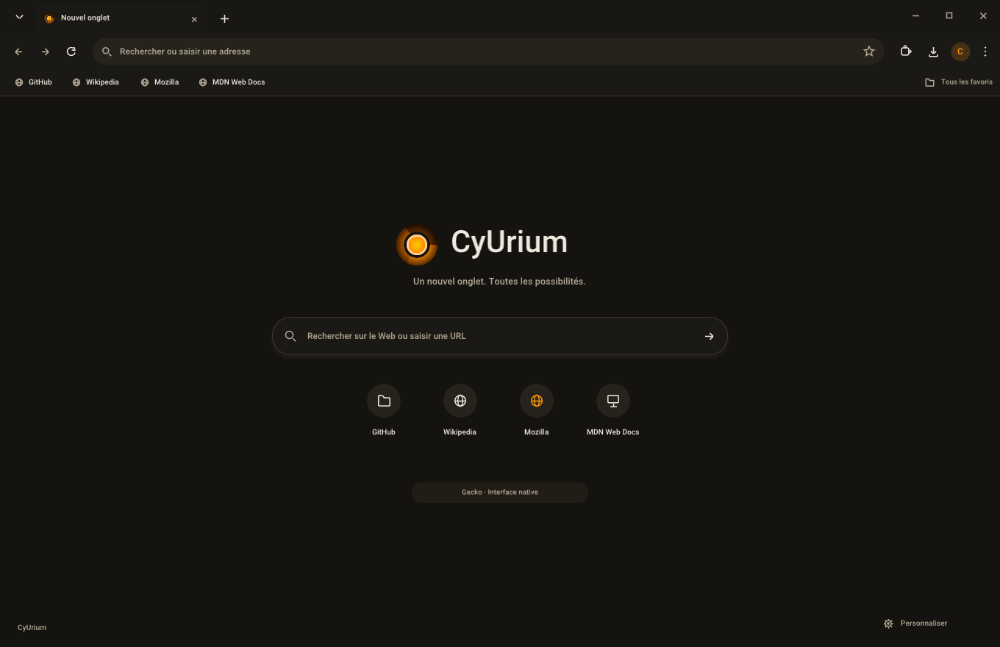

<p align="center">
  
</p>

# CyUrium

A native desktop browser with a Chrome-inspired interface, built with **C++20,
Dear ImGui and SDL3 GPU**, powered by **Gecko**.

**Version 0.3.0 — Windows alpha.** Web browsing is functional on Windows.
The macOS and Linux builds currently provide the desktop interface; their
native Gecko integration still needs to be ported. Android and Meta Quest
remain in the separate [CyVR_Urium](https://github.com/MrMybal/CyVR_Urium) project.



CyUrium uses CyVR_Urium's original logo and a dark brown and amber theme.
The interface supports multiple native windows, draggable tabs, alternative
themes, and a native conversation sidebar backed by CyToolsCore.

Free software under **GNU GPL version 3 only** (`GPL-3.0-only`). See [LICENSE](LICENSE)
and [NOTICE](NOTICE). Dependencies retain their [respective licenses](THIRD_PARTY_NOTICES.md).

## Getting started on Windows

Run **Start-CyUrium.cmd**. It opens the application in `dist/windows/CyUrium/`
or builds it if the executable is missing. Building requires the tools listed below.

Tabs can be reordered, dragged into another window, or dropped outside the tab
bars to create a new window. The page, form state and navigation history stay
with the tab. A drag preview and insertion marker show the destination;
Escape cancels the operation. Closing a window's last tab closes that window.
Bookmarks and preferences are shared across windows.

Settings, bookmarks, history, downloads and extensions each open in a new tab.
The original page keeps its own tab and playback state. The address bar supports
URLs and web searches. Light and dark themes and interface scaling from 85% to
150% are available in Settings.

## Browser features

- **Gecko browsing:** independent content processes, real HTML/JavaScript and
  network navigation, back/forward history, TLS status and certificate details.
- **Downloads:** progress, pause/resume, cancellation, retry, opening files and
  their folder, and a persistent download list. Downloaded `.xpi` files can be
  installed from that list.
- **Extensions:** Mozilla-signed `.xpi` installation with permission confirmation,
  enable/disable, removal, Mozilla update checks, options pages and HTML popups.
- **Built-in ad blocking:** Mozilla-signed **uBlock Origin 1.75.0** is bundled and
  installed automatically for new and existing profiles, without an installation
  download. Navigation waits for its filters to initialize. Disabling or removing
  it is respected after restart; an existing installation is preserved.
- **Site permissions:** temporary or saved decisions with per-origin rules in
  Settings. Dedicated handlers cover location, notifications, camera/microphone,
  screen capture with device selection, clipboard, persistent storage, MIDI,
  XR and local network requests. Unknown requests are denied and reported.
- **Sessions and recovery:** window positions, selected tabs and navigation
  history are restored. Session snapshots use atomic replacement and a backup.
  The engine can restart with its pages after a crash, with a limit of three
  closely spaced automatic restarts and a manual restart option.
- **Hardware acceleration:** SDL_GPU renders the interface; Gecko/WebRender
  renders web content on Windows. The persistent GPU setting takes effect after
  an engine restart. Gecko's driver compatibility decisions remain in effect.

Session form restoration is **off by default** and currently available on
Windows. Passwords, file inputs, hidden fields, recognized payment-card fields
and one-time codes are excluded. Session snapshots and their backup use Windows
DPAPI for the current account. This does not encrypt settings, typed-address
history or the entire Gecko profile.

This is an alpha. Some WebExtensions depend on Firefox interface APIs that still
need adaptation, including some tab/window creation paths, sidebars and context
menus. HTML/video fullscreen, accessibility, device compatibility and broader
site coverage need further validation.

## Native conversation panel and MCP / SDK

The **Conversation** button opens a resizable native sidebar. Conversations have
separate drafts, transcripts and provider sessions. The packaged Windows SDK
uses **CyToolsCore 0.10.1** with its own Python runtime and the existing
**CyUEMCPSDK 0.1.8** connectors; no system Python is required to run it.

Available connectors include Codex App Server / CLI JSONL, Claude CLI,
Antigravity, OpenCode, Ollama, Claude API and OpenRouter. CLI connectors use
their own authentication. API configuration stores an **environment variable
name**, rather than an API key.

Page content is attached only when requested. Browser tools are read-only by
default, and page control requires explicit activation. External MCP access is
separately enabled in **Settings > System**; opening the conversation panel does
not enable it. Codex App Server browser tools use its experimental dynamic-tool
protocol and require a compatible installed version.

See the [SDK guide](docs/sdk.md) for setup, supported operations and limitations.

## Building

Requirements: **Python 3**, **CMake 3.24+**, a C++20 toolchain and a compatible GPU
driver. Windows also requires **7-Zip** to prepare Gecko.

```sh
python tools/build.py
python tools/build.py --run
python tools/build.py --configuration Debug
```

| Platform | Toolchain | Output | Web engine status |
| --- | --- | --- | --- |
| Windows x64 | Visual Studio 2022 C++ tools, Windows SDK, CMake/Ninja | `dist/windows/CyUrium/` | Gecko integrated |
| macOS | Xcode command-line tools and CMake | `dist/macos/CyUrium.app` | Native integration pending |
| Linux | C++20 compiler, CMake, X11/Wayland development libraries | `dist/linux/CyUrium/` | Native integration pending |

The Windows build selects the local toolchain without changing the machine's
persistent environment and links the C++ runtime statically. macOS and Linux
builds are defined in CMake and the CI matrix; execution on those systems has
not yet been validated locally.

Debian/Ubuntu dependencies used by CI:

```sh
sudo apt install build-essential cmake ninja-build pkg-config libx11-dev libxext-dev libxrandr-dev libxcursor-dev libxfixes-dev libxi-dev libxss-dev libxkbcommon-dev libwayland-dev wayland-protocols libegl1-mesa-dev libdrm-dev libgbm-dev libdecor-0-dev
```

The renderer prefers **Direct3D 12** on Windows, **Metal** on macOS and **Vulkan**
on Linux. Linux multi-window positioning currently requires **X11 or XWayland**;
the ImGui/SDL3 backend lacks the required global coordinates on native Wayland.
X11 is preferred when available unless an SDL video driver is explicitly selected.

Dependencies are pinned: Dear ImGui **1.92.5-docking**, SDL **3.2.28** and the
Windows Gecko runtime **ESR 153.6.0**. Build scripts download official upstream
archives and verify their hashes. A small CyUI source snapshot provides palette,
DPI and settings controls, adapted to the browser's appearance.

## Engine architecture

The Windows package includes a dedicated Gecko runtime extracted from the
official Firefox ESR distribution. Mozilla's launcher starts CyUrium's XUL
application with its own identity and profile. **No installed Firefox is
required.** CyUrium's native interface provides the visible windows, tabs and
controls; the Firefox browser interface is not loaded.

Each web tab has a native surface. Moving a tab reparents that surface while
preserving its document and history, without copying page rendering through
CPU memory. Gecko starts on demand when the first website is opened.
The classic interface is separate from the tab/window controller so that other
interfaces can be developed later.

The local privileged bridge uses mutual HMAC-SHA-256 challenges with a random
256-bit secret, bounded messages and process/window identity checks. Content
process isolation and Windows sandboxing are enabled. These mechanisms do not
replace a comprehensive security review across sites, extensions and platforms.

See the [architecture notes](docs/architecture.md).

## Keyboard shortcuts

Use Cmd instead of Ctrl on macOS.

| Shortcut | Action |
| --- | --- |
| Ctrl+T / Ctrl+W | Open / close a tab |
| Ctrl+N / Ctrl+Shift+W | Open / close a window |
| Ctrl+Q | Quit all windows |
| Ctrl+L or F6 | Focus the address bar |
| Ctrl+Tab / Ctrl+Shift+Tab | Switch tabs |
| Ctrl+1–9 | Select a tab |
| Alt+Left / Alt+Right | Back / forward |
| Ctrl+D | Add / remove a bookmark |
| Ctrl+Shift+B | Toggle the bookmarks bar |
| Ctrl+H / Ctrl+J | Typed-address history / downloads |
| Ctrl+, | Settings |
| Ctrl++ / Ctrl+- / Ctrl+0 | Interface scale |
| F11 | Fullscreen |

## Updates through GitHub Releases

**Settings > System** provides manual update checks, downloads and installation.
Update manifests require an **ECDSA P-256 / SHA-256** publisher signature.
The updater checks the ZIP hash and individual files before replacement.
A failed shell or Gecko service startup triggers rollback to the previous
installation. No system service is installed.

The updater is designed for a **dedicated public Releases repository**, with
stable/preview channels and daily automatic checks while Gecko is active.
Downloads and installation remain manual. The source repository is configured
separately; no GitHub access token is embedded in the application.

**The public Releases repository and publisher key are not configured yet.**
The private signing key must remain outside the source tree. The maintainer
CLI prepares the configuration, staging directory and signed packages:

```sh
python tools/release.py keygen --key /path/outside/repository/release-private.pem
python tools/release.py configure --repository YOUR_ACCOUNT/CyUrium-Releases --key /path/outside/repository/release-private.pem --version 0.3.1
python tools/build.py
python tools/release.py stage --output dist/release-source/CyUrium
python tools/release.py package --source dist/release-source/CyUrium --key /path/outside/repository/release-private.pem --version 0.3.1 --repository YOUR_ACCOUNT/CyUrium-Releases
```

Use an absolute path appropriate for your system for the private key. The
release workflow can prepare signed artifacts and, when explicitly requested,
a draft Release. A full package includes Gecko; update its lock and application
versions before publishing. See the [release guide](docs/releases.md) for
configuration, signing, corresponding-source distribution and current limits.

## Testing and performance

The shell waits for events when idle; Gecko composes web content independently.
`--metrics` measures the **interface process only**, excluding Gecko processes
and GPU memory. Interface-only measurements are not browser benchmarks.

The build runs native tests for browser state, multi-window tab dragging,
session recovery, the privileged bridge and ImGui interactions. Additional
Windows integration checks exercise the real engine and packaged services:

```sh
python tools/build.py --core-only
python tools/test_web.py
python tools/test_web.py --debug
python tools/test_services.py
python tools/test_services.py --extensions
python tools/test_adblock.py
python tools/test_session.py
python tools/test_updater.py
python tools/test_update_channel.py
python tools/test_security.py
python tools/test_bridge_peer.py
python tools/test_sdk.py
python tools/test_assistant.py
python -m unittest discover -s tests -p test_release.py
```

The web scenario checks a local HTTP fixture, HTML/JavaScript, form state,
back/forward history, tab detachment/attachment and HTTPS navigation to
example.org. It writes its report and Gecko capture under `.runtime/qa/web/`.
A working desktop, GPU and network connection are required.

```sh
CyUrium --url https://example.org --profile profile-test
CyUrium --capture home.bmp --scenario home
CyUrium --window-test native-windows.json
```

`--capture` and `--window-test` exercise the interface without starting Gecko.
See the [Windows validation notes](docs/validation.md) and
[third-party notices](THIRD_PARTY_NOTICES.md) for more details.
